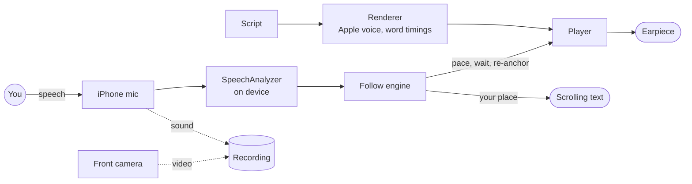

<p align="center"></p>

# Earwig

**An iPhone app that reads your script into one earpiece a few words ahead of you, and follows what you actually say. It is also a teleprompter that scrolls the script on the phone's screen as you speak.**

Pre-release · iOS 26 or later · everything happens on the phone · [source-available](#licence)

## What it's for

You film yourself talking to camera: walking a footpath with the camera on a gimbal, or sitting at a desk. Often you can't look at a teleprompter, and you don't want to learn the script.

That is what Earwig was designed for. It reads the script into one Bluetooth earpiece, a few words ahead of you, in a natural Apple voice. You hear the line and say it. Earwig listens to you on the iPhone's own microphone while you do:

- it waits at the end of a phrase when you pause;
- it keeps pace when you speed up or slow down;
- after a stumble, or a few words off script, it picks you up where you are.

The phone can stay locked in your pocket.

When you can see the phone, Earwig is also a teleprompter (an autocue). Choose **Screen Only** and it scrolls the script on the screen as you speak, with no earpiece and no voice. It uses the same engine that follows you by ear, so it waits when you pause and moves when you go on. Your line sits at eye level and the words you have said fade. Prop the phone by the camera, or use it on a mount.

Or have both, the voice in your ear and the script on screen. You can also record each take, sound or video, to check it afterwards.

## How it works



1. Before a take, the step you are about to read is rendered in an Apple voice, with the time of every word. It is held in memory, never saved.
2. During the take, Apple's on-device `SpeechAnalyzer` turns what you say into words.
3. The follow engine matches those words to the script. It allows for numbers, spellings, contractions and the odd misheard word. It also allows for the recogniser's own delay, to work out where you are now.
4. From that it paces the voice to stay a set lead ahead of you, and decides when to wait.

There are no accounts, no network and no servers, and nothing leaves the phone.

<p align="center"></p>

## Your first take

Earwig comes with four made-up sample scripts, so you can try it before you have pasted anything. Start without the earpiece.

1. Open **The Harbour Walk** under **Samples**.
2. On the start card at the top, tap **Listen to Step 1**. You hear what a take sounds like: the slate, the tones, then the step read straight through. Tap **Done**.
3. Choose **Screen Only** on the start card, then tap **Start Take 1** on step 1's card. This is Earwig as a teleprompter. With no voice to render, the take starts straight away.
4. Read the step aloud at your own pace. The text rises to keep your line a third of the way down, and the words you have said fade.
5. Stop in the middle of a sentence. The text waits for you. Go on, and it follows again. At the end of the step the take finishes by itself. Tap **Done**.

Now put the earpiece in.

6. Choose **With Voice** and tap **Start Take 2**. You hear three tones, then the voice starts the first phrase.
7. Start speaking a moment after the voice, and stay a few words behind it. You never need to catch it up: it keeps its lead by speeding up or slowing down a little to match you.
8. Pause at the end of a sentence. The voice finishes the phrase and waits. When you go on, so does it.
9. Stumble on purpose, and say the sentence again from its start. The voice waits while you do and carries on with you. If you lose your place altogether, tap **Back** (⏮) to hear the phrase again.
10. At the end, **Next Take** gives you take 3 of the same step, and **Done** goes back to the script.

Then paste a script of your own.

## Features

### Scripts

- **Paste a script.** Copy the text on your Mac, then tap **Paste** on the Scripts screen; Universal Clipboard brings it across. Earwig reads two formats.

  Markdown: a `# ` title, numbered `## ` steps, and the lines to say as bullets under `Says:`. `Shows:`, `Footage:` and `Open:` lines are directions; they are shown but not spoken.

  ```markdown
  # Script: The Harbour Walk

  ## 1. Setting off
  Shows: Presenter at the harbour wall, boats behind.
  Says:
  - Morning! We're starting at the old harbour, just as the tide turns.
  - [Gesture to the boats] Most of these boats go out at first light.
  ```

  Plain text: blocks separated by blank lines are steps. A short first line with no full stop is the step's title. A lone first line is the script's title.

  ```text
  The Seaside Pier

  The entrance
  This pier opened in 1899, and for a while it was the longest on the coast.
  [Gesture along the boards] It runs out nearly a third of a mile.
  ```

- **Stage directions.** Anything in square brackets inside a line is a stage direction, such as a gesture or a look. During a take it is chimed (the default) or spoken in a second voice. Choose which under **Stage Directions** in Settings.
- **Pasting again.** Pasting the same text again opens the script you already have. Pasting a script with the same title replaces its text and keeps its takes. For a script whose title has changed, use **Paste New Version** at the foot of its Script screen.
- **Samples.** *The Harbour Walk*, *The Weekend Loaf*, *The Old Watermill* and *The Seaside Pier* are always there, below your own scripts. They can't be deleted, and their takes are kept like any other script's.
- **Deleting a script.** Swipe a script of your own to delete it, or tap **Delete Script** at the foot of its Script screen. Its takes go with it.
- **iOS's paste prompt.** iOS asks "Allow Paste?" on each paste until you set **Settings › Apps › Earwig › Paste from Other Apps** to **Allow**.

### The Script screen

- **Steps.** Each step's card shows its directions, its lines and its takes so far. Tap a step to start takes from it; the start step is marked with a bar down its side.
- **The start card** at the top:
  - **With Voice** or **Screen Only**;
  - **Record**: **Off**, **Sound** or **Video**;
  - **Read Cues**, for this script: the step's name and its `Shows:` text in the slate, and its directions during the take;
  - the step's rendering progress;
  - **Listen to Step N**.
  Mode and Record are remembered, and they are the same settings as in Settings.
- **Listen** plays the step straight through: the slate, the tones and every line, at 0.85×, 1× or 1.2×, with the words lit as they are spoken. Nothing is recorded.

### As a teleprompter

**Screen Only** makes Earwig a teleprompter. It follows your voice: the script scrolls as you read, waits when you stop, and keeps your line a third of the way down. There is no earpiece, no voice and nothing to render, so a take starts at once. Everything else works as in a take With Voice: the controls, the text size, recording, and the camera behind the text. Choose it on the start card or under **Mode** in Settings. A scroll at a fixed pace, for when Earwig can't hear you, is not built yet ([#31](https://github.com/bowerhaus/Earwig/issues/31)).

### Starting a take

- **Start Take N** on the start step's card opens the take. Takes are numbered per step, so the slate and the file names match your shot log.
- **Getting ready:** Earwig sets up the microphone, the audio and listening. The first time, it may download Apple's British English speech model.
- **The start**, chosen in Settings:
  - **Tones only** (the default): three tones, then the voice starts.
  - **Slate alone:** the slate ("Step 2, take 3") is read in your ear, with a pause for you to say it to the camera, then the tones.
  - **Slate with a reply:** as Slate alone, but Earwig listens for you to say the slate back, or for a tap on the screen, before the tones.
- **The route check:** two icons at the top of the screen show where the sound goes and where Earwig is listening. A note appears if something is wrong, for example "The earpiece is in hands-free mode: reconnect it." The earpiece must play over Bluetooth A2DP, the music mode. The microphone is always the iPhone's own.

### During a take

- **The voice** stays a set lead ahead of you, five words by default. It waits at a phrase end when you pause. It speeds up or slows down a little to keep the lead (**Hybrid** pacing), or only waits (**Phrase-gated**). If you skip ahead or go back, it re-anchors to where you are.
- **The text** keeps the line you are reading a third of the way down, and fades the words you have said.
  - Pinch to change the text size.
  - Drag to look ahead; three seconds after you let go, it glides back to your place.
  - Turn on **Light the Voice's Phrase** in Settings to see the voice's phrase lit as it is spoken.
- **The status** shows what the take is doing: **Speaking**, **Waiting**, **Reading**, **Lost** (it can't place you: say a line of the script), **Held** or **Finished**.
- **The controls** along the bottom:

  | Control | What it does |
  |---|---|
  | ⏮ Back | Back one phrase, and the voice gives it again |
  | ⏸ Hold | Stops the voice and the text until you release it |
  | ⏭ Forward | On one phrase |
  | ↻ Restart | Back to the tones and the start of the step |
  | ⏹ Stop | Ends the take |

  During the slate, a tap on the text skips straight to the tones.
- **Locking the phone:** the take carries on, voice and listening included. A video recording stops, but its sound goes on.
- **What ends a take:**
  - reaching the end of the step;
  - **Stop**;
  - a phone call;
  - listening that has given up, which says why.
  Taking the earpiece out holds a take With Voice, so the room doesn't hear the voice; release **Hold** to go on.
- **Finished:** the take's result, then **Next Take** for the same step again, or **Done**.

### Recording

- **Sound** records the iPhone's microphone. **Video** adds the front camera at 1080p (the default) or 4K, at 30 frames a second.
- **Framing:** a video take opens on the camera's preview so you can frame the shot, then **Start**.
- **Camera Behind the Text** (on by default) keeps the camera behind the scrolling text. A slider on the preview sets how bright the text is over it.
- **After the take:** **Play Video**, **Play Sound** (or **Play Back** for a sound-only take), and **Share**.
- **Where the files go:** recordings are in the Files app, under **On My iPhone › Earwig**.
  - With **Keep Recordings** off (the default), each recording replaces the last.
  - **Delete All Recordings** in Settings clears them.
  - With less than 1 GB free, only the sound is recorded.

### Settings

From the gear on the Scripts screen.

| Group | Settings |
|---|---|
| Voice | **Voice**: your Personal Voice, if you have one and allow it (**Allow Personal Voice**), or any English voice of Enhanced quality or better, British first; **Stage Directions** (Chime or Spoken) |
| Following | **Lead** (2 to 6 words, default 5, with the seconds it comes to), **Pacing** (Hybrid or Phrase-gated), **Voice speed** (0.80× to 1.00×, default 0.95×) |
| Start | **Slate with a reply**, **Slate alone** or **Tones only** (default) |
| Screen | **Mode** (With Voice or Screen Only), **Light the Voice's Phrase**, **Text size** (24 to 72 pt, default 40) |
| Recording | **Record** (Off, Sound or Video), **Video Quality**, **Camera Behind the Text**, **Keep Recordings**, the space used, **Delete All Recordings** |
| Diagnostics | **Listening Check**: shows where the sound goes and where Earwig listens, and the words it hears with how late each one was. **Say Test** plays a line through the earpiece; with the earpiece in, none of it should appear among the heard words. |

<p align="center">
  &nbsp;&nbsp;
  &nbsp;&nbsp;
  
</p>

## Requirements

- An iPhone with iOS 26 or later.
- A Bluetooth earpiece that plays in A2DP, its music mode. One earpiece is enough. Earwig never uses the earpiece's microphone.
- A good English voice, downloaded in **Settings › Accessibility › Spoken Content › Voices › English**. Earwig uses **Stephanie (Enhanced)** if it is there; the Script screen says so if it isn't.
- Apple's British English speech model. Earwig downloads it on first use, and the Listening Check shows its state.

## Tips

- The defaults (a five-word lead, Hybrid pacing, 0.95× voice speed, tones only) were chosen by ear on real takes. Change one at a time.
- In a pocket, lock the phone: the take carries on and follows you, and the voice waits whenever you stop.
- The recogniser mishears unusual words; one script's "leat" (a mill stream) came out as "elite". A misheard word doesn't throw Earwig, which looks for the next words it knows.
- Run the **Listening Check** with a new earpiece, to see that the sound goes to it and the listening stays on the iPhone.

## Building from source

Earwig is built from source; there is no download. You need a Mac with Xcode 27 or later, an Apple developer account (a free one works for your own phone), [XcodeGen](https://github.com/yonaskolb/XcodeGen) and, to lint, [SwiftLint](https://github.com/realm/SwiftLint):

```bash
brew install xcodegen swiftlint
```

Set your own team in `project.yml` (`DEVELOPMENT_TEAM`), and your own bundle identifier if you like, then:

```bash
xcodegen generate
xcodebuild -scheme Earwig -destination 'platform=iOS Simulator,name=iPhone 17' -derivedDataPath build/DerivedData test
swiftlint lint --quiet
```

Listening, the voice, the earpiece and the camera need a real iPhone. To install on yours, find its identifier with `xcrun devicectl list devices`, then:

```bash
xcodebuild -scheme Earwig -destination 'id=<UDID>' -derivedDataPath build/DerivedData -allowProvisioningUpdates build
xcrun devicectl device install app --device <UDID> build/DerivedData/Build/Products/Debug-iphoneos/Earwig.app
```

The project uses only Apple's frameworks, with no third-party dependencies. `Earwig.xcodeproj` is generated, so add or remove files and run `xcodegen generate` again. The follow engine (`Earwig/Engine/`) is pure Swift and is tested with simulated takes in `EarwigTests/Simulation/`.

## Status

Earwig is a personal app, built in stages for its author's own videos and shared as it goes. The [product requirements](PRD.md) describe what it is meant to do, §12 lists the stages, and [`plans/`](plans/) holds the plan for each one. This is a pre-release. Known issues:

- [#30](https://github.com/bowerhaus/Earwig/issues/30): a stumble in the last phrase of a step can end the take a few words short.
- [#33](https://github.com/bowerhaus/Earwig/issues/33): the route check's green is pale, and its icons appear late.

Other ideas and bugs are in the [issues](https://github.com/bowerhaus/Earwig/issues).

### Releases

Each release is a tag on `main` (`v0.1.0`, …) with notes on the [Releases](https://github.com/bowerhaus/Earwig/releases) page, marked pre-release until 1.0. Releases carry no app to download, because an iPhone app installs only when it is signed for your device: build it from source as above.

## Licence

Earwig is source-available under the [PolyForm Noncommercial License 1.0.0](LICENSE), with one additional permission.

- You may use, change and share the code for any non-commercial purpose, keeping the licence and its copyright notice with it.
- You may use the app to make your own videos, recordings and other works, for any purpose, including commercial ones.
- Selling the app, distributing it commercially or building it into another product needs the author's permission.

The [`LICENSE`](LICENSE) file is what counts.
