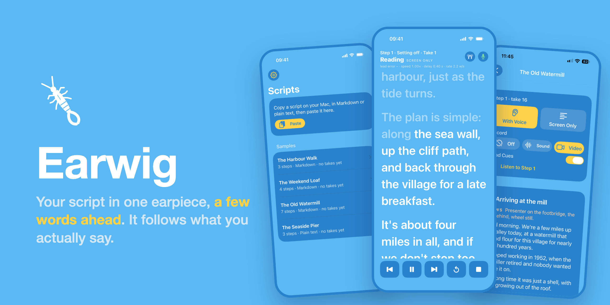
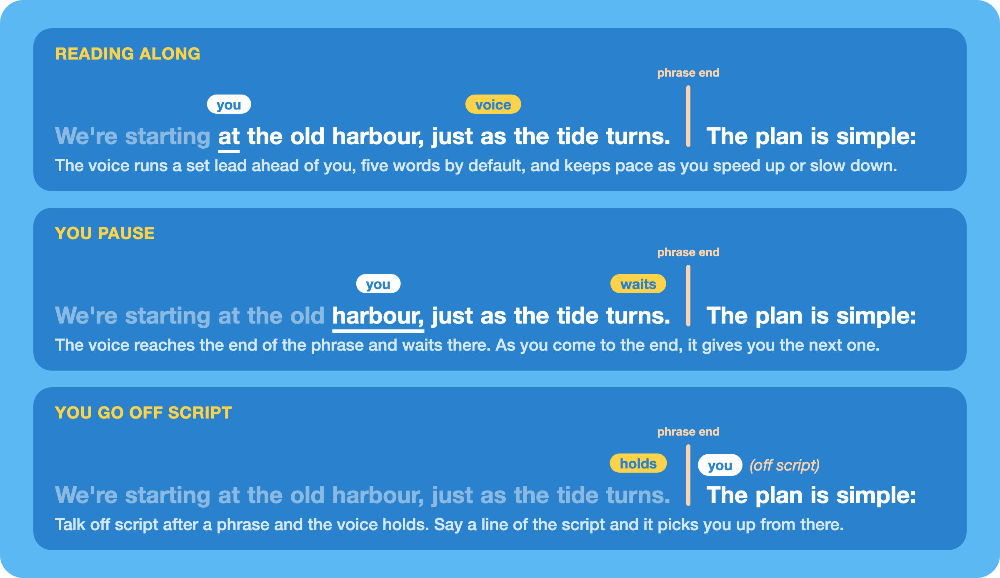
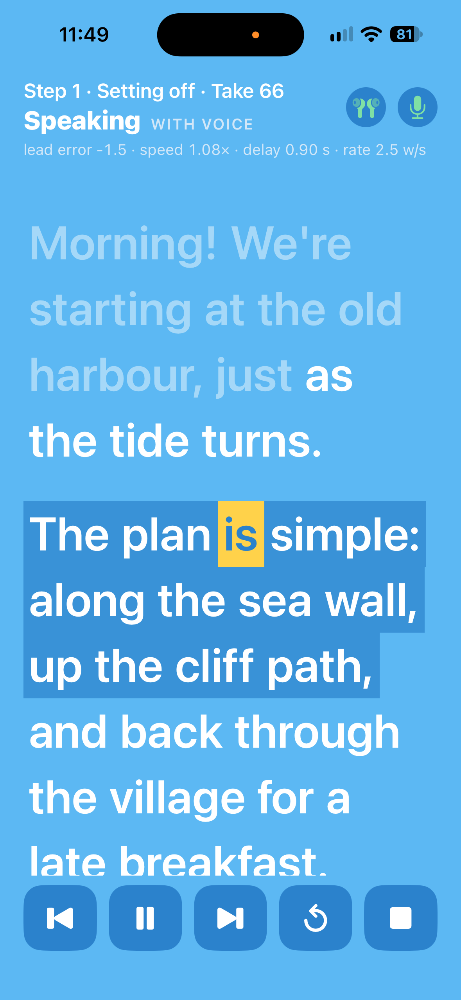
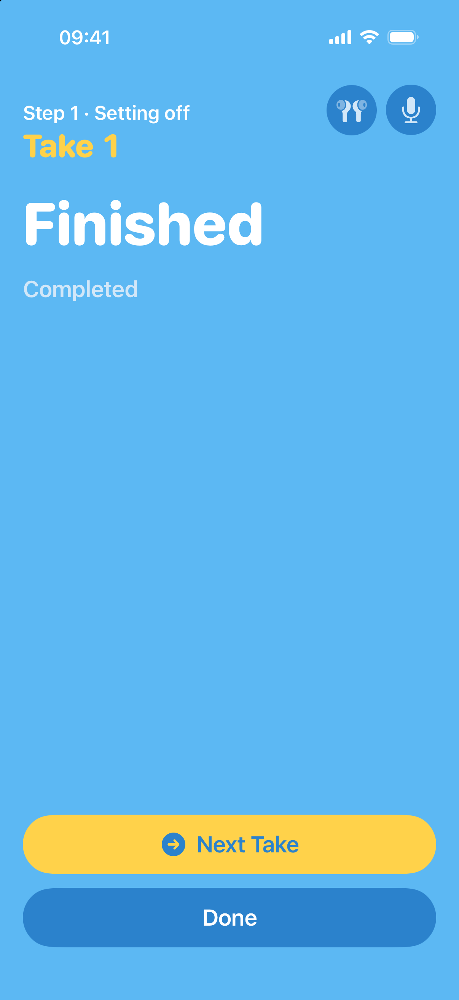
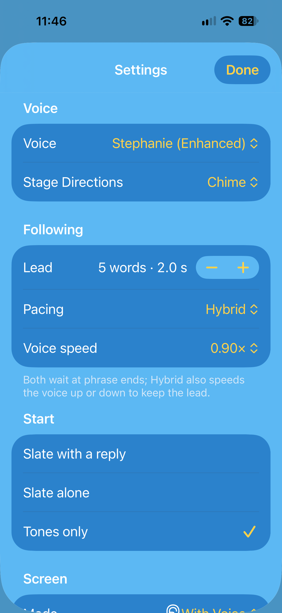

<p align="center"></p>

# Earwig

**Earwig is an ear prompter for the iPhone. It reads your script into one earbud a few words ahead of you, and follows what you actually say. It can also act as a standard teleprompter that scrolls the script on screen as you speak.**

Pre-release · iOS 26 or later · everything happens on the phone · [source-available](#licence)

## What it's for

When you film yourself talking to a camera, often you can't look at a teleprompter, or you don't want to because your eyes appear to be reading. You don't have time to learn the script, and this is where Earwig can help out.

It is an ear prompter that reads your script into a normal Bluetooth earbud in a natural Apple voice. But better than just listening to a recording, it stays a few words ahead of you, and you hear the lines and say them at your own pace. Earwig keeps time with your speech and allows you to go back and correct mistakes if you need to. You can even go off piste and come back on script when you're ready.

It listens on the iPhone's own microphone, so the phone can stay locked in your pocket while you walk and talk.

When you can see the phone, on a mount by the camera or propped on the desk, Earwig works as a standard teleprompter (or autocue) too. Choose **Screen Only** and the script scrolls on screen as you speak, with no earbud and no voice. It's the same engine that follows you by ear, so it waits when you pause and moves on when you do. Or have both at once: the voice in your ear and the script on screen.

You can also record each take, sound or video, so you can check it afterwards.

## How it works


Before each take, Earwig renders the step you're about to read in an Apple voice, noting the time of every word. It keeps this in memory and never saves it.

During the take, Apple's on-device `SpeechAnalyzer` turns what you say into words, and Earwig's follow engine matches them against the script. It copes with numbers, spellings, contractions and the odd misheard word. It also allows for the delay before the recogniser reports a word, so it knows where you are now rather than where you were. From that it paces the voice to stay a set lead ahead of you, and decides when to wait.

There are no accounts, no servers and no network, and nothing leaves the phone.

<p align="center"></p>

## Before you start: get a good voice

Earwig usually uses two voices: one reads your script, and a second reads the slate and any stage directions you've chosen to hear spoken. Your iPhone comes with only the basic, compact voices, and they sound robotic, so download better ones before you try Earwig, or the first thing you hear will put you off. It only takes a couple of minutes:

1. On the iPhone, open **Settings › Accessibility › Read & Speak › Voices › English**.
2. The page lists the voices, and you can play a preview of each one. Any that isn't on the phone yet has a little cloud icon: tap it to download.
3. Download **Stephanie (Enhanced)** for your script and **Jamie (Premium)** for the cues. Earwig was tested with these two and picks them up by itself.

The downloads are fairly large, so do them on Wi-Fi. If Stephanie isn't there, Earwig says so on the Script screen and uses the best voice it can find, and you can choose any other Enhanced or Premium English voice under **Voice** in Earwig's Settings.

## Your first take

Earwig comes with four made-up sample scripts, so you can try it out before pasting anything of your own. Make sure you've [downloaded a good voice](#before-you-start-get-a-good-voice) first, then start without the earbud.

1. Open **The Harbour Walk** under **Samples**.
2. On the start card at the top, tap **Listen to Step 1**. This plays the step the way a take sounds: the slate, the tones, then the lines read straight through. Tap **Done** when you've heard enough.
3. Choose **Screen Only** on the start card, then tap **Start Take 1** on the step's card. This is Earwig as a teleprompter, and with no voice to prepare, the take starts straight away.
4. Read the step aloud at your own pace. The text rises to keep your line a third of the way down, and the words you've said fade.
5. Stop in the middle of a sentence and the text waits for you. Carry on and it follows again. At the end of the step the take finishes by itself, so tap **Done**.

Now put the earbud in.

6. Choose **With Voice** and tap **Start Take 2**. You'll hear three tones, then the voice starts the first phrase.
7. Start speaking a moment after the voice, a few words behind it. You never have to catch it up, because it speeds up or slows down a little to keep its lead on you.
8. Pause at the end of a sentence. The voice finishes the phrase and waits, and when you go on, so does it.
9. Stumble on purpose and start the sentence again. The voice waits while you correct yourself and carries on with you. If you lose your place altogether, tap **Back** (⏮) to hear the phrase again.
10. At the end, **Next Take** gives you take 3 of the same step, and **Done** takes you back to the script.

Speaking just a couple of words behind a voice in your ear feels odd at first, and it takes a little practice to get used to. Don't give up too easily: after a few takes it starts to feel natural, and that's when Earwig really helps.

Then paste in a script of your own.

## Features

### Scripts

- **Paste a script.** Copy the text on your Mac, then tap **Paste** on the Scripts screen and Universal Clipboard brings it across. Earwig reads two formats.

  Markdown, with a `# ` title, numbered `## ` steps, and the lines to say as bullets under `Says:`. Lines starting `Shows:`, `Footage:` or `Open:` are directions: they're shown on the Script screen but never spoken.

  ```markdown
  # Script: The Harbour Walk

  ## 1. Setting off
  Shows: Presenter at the harbour wall, boats behind.
  Says:
  - Morning! We're starting at the old harbour, just as the tide turns.
  - [Gesture to the boats] Most of these boats go out at first light.
  ```

  Or plain text, where each block separated by a blank line is a step. A short first line with no full stop is the step's title, and a lone line at the top is the script's title.

  ```text
  The Seaside Pier

  The entrance
  This pier opened in 1899, and for a while it was the longest on the coast.
  [Gesture along the boards] It runs out nearly a third of a mile.
  ```

- **Stage directions.** Anything in square brackets inside a line is a stage direction, like a gesture or a look. During a take you hear a chime at that point (the default), or the direction read out in a second voice. Choose which under **Stage Directions** in Settings.
- **Pasting again.** Paste the same text again and Earwig simply opens the script you already have. Paste a script with the same title and it replaces the text but keeps your takes. If the title has changed, use **Paste New Version** at the foot of the Script screen.
- **Samples.** *The Harbour Walk*, *The Weekend Loaf*, *The Old Watermill* and *The Seaside Pier* are always there, below your own scripts. You can't delete them, and their takes are kept like any other script's.
- **Deleting a script.** Swipe one of your own scripts and tap **Delete**, or tap **Delete Script** at the foot of its Script screen. Earwig asks first, since its takes go with it.
- **The paste prompt.** iOS asks "Allow Paste?" every time until you set **Settings › Apps › Earwig › Paste from Other Apps** to **Allow**.

### The Script screen

- **Steps.** Each step's card shows its directions, its lines and the takes you've done. Tap a step to start your takes from there; the start step has a bar down its side.
- **The start card** at the top is where you set up the next take. Choose **With Voice** or **Screen Only**, and whether to **Record** (**Off**, **Sound** or **Video**). **Read Cues** decides, for this script, whether the slate reads out the step's name and its `Shows:` line, and whether you hear its directions during the take. The card also shows the voice being prepared, and **Listen to Step N** once it's ready. Your choice of mode and recording is remembered, and matches the same settings in Settings.
- **Listen** plays the step straight through, with the words lit as they're spoken, at 0.85×, 1× or 1.2×. It's a handy way to hear a script before you film it, and nothing is recorded.

### As a teleprompter

**Screen Only** turns Earwig into a teleprompter that follows your voice. The script scrolls as you read and waits when you stop, keeping your line a third of the way down. There's no earbud, no voice and nothing to prepare, so a take starts at once. Everything else works just as it does with the voice: the controls, the text size, recording, and the camera behind the text. Choose it on the start card or under **Mode** in Settings. A scroll at a fixed pace, for when Earwig can't hear you, isn't built yet ([#31](https://github.com/bowerhaus/Earwig/issues/31)).

### Starting a take

- **Start Take N** on the start step's card opens the take. Takes are numbered for each step, so the slate and the file names match your shot log.
- **Getting ready.** Earwig sets up the microphone, the audio and listening. The very first time, it may need to download Apple's British English speech model.
- **How a take starts** is your choice in Settings:
  - **Tones only** (the default): three tones, then the voice starts.
  - **Slate alone:** the slate ("Step 2, take 3") is read into your ear, with a pause for you to say it to the camera, then the tones.
  - **Slate with a reply:** the same, but Earwig waits to hear you say the slate back, or for a tap on the screen, before the tones.
- **The route check.** Two icons at the top of the take show where the sound is going and where Earwig is listening, and a note appears if something is wrong, such as "The earpiece is in hands-free mode: reconnect it." The earbud needs to play in its normal music mode (Bluetooth A2DP), and Earwig always listens on the iPhone's own microphone.

### During a take

- **The voice** stays a set lead ahead of you, five words by default, and waits at the end of a phrase when you pause. With **Hybrid** pacing it also speeds up or slows down a little to keep that lead; with **Phrase-gated** it only waits. If you skip ahead or go back, it finds where you are and carries on from there.
- **The text** keeps the line you're reading a third of the way down and fades the words you've said. Pinch to change the text size. Drag to look ahead, and three seconds after you let go it glides back to your place. Turn on **Light the Voice's Phrase** in Settings to see the voice's phrase lit as it's spoken.
- **The status** at the top tells you what the take is doing: **Speaking**, **Waiting**, **Reading**, **Held**, **Finished**, or **Lost** when it can't place you (say a line of the script and it will find you).
- **The controls** along the bottom:

  | Control | What it does |
  |---|---|
  | ⏮ Back | Goes back a phrase, and the voice gives it to you again |
  | ⏸ Hold | Stops the voice and the text until you let go of it again |
  | ⏭ Forward | Moves on a phrase |
  | ↻ Restart | Back to the tones and the start of the step |
  | ⏹ Stop | Ends the take |

  During the slate, tap the text to skip straight to the tones.
- **Locking the phone** doesn't stop the take: the voice and the listening carry on. A video recording stops, but its sound keeps going.
- **A take ends** when you reach the end of the step, tap **Stop**, or get a phone call, or if listening gives up, when it tells you why. Taking the earbud out holds a take with the voice, so the room doesn't hear it; release **Hold** to carry on.
- **Finished** shows how the take went, with **Next Take** to go again on the same step, or **Done**.

### Recording

- **Sound** records the iPhone's microphone, and **Video** adds the front camera, at 1080p (the default) or 4K, 30 frames a second.
- **Framing.** A video take opens on the camera's preview so you can frame the shot before you tap **Start**.
- **Camera Behind the Text** (on by default) shows the camera behind the scrolling text, and a slider on the preview sets how bright the text is over it.
- **After the take** you can **Play Video** or **Play Sound** (or **Play Back** for a sound-only take), and **Share** it.
- **Where the files go.** Recordings are in the Files app, under **On My iPhone › Earwig**. With **Keep Recordings** off (the default), each recording replaces the last, and **Delete All Recordings** in Settings clears them out. If there's less than 1 GB free, only the sound is recorded.

### Settings

Tap the gear on the Scripts screen.

| Group | Settings |
|---|---|
| Voice | **Voice**: your Personal Voice, if you have one and allow it (**Allow Personal Voice**), or any English voice of Enhanced quality or better, British first. **Preview** plays a line in it at the voice speed, through the earbud if it's in. **Voice Speed** (0.80× to 1.00×, default 0.95×). **Cue Voice**: Automatic, a voice of the other gender so a cue never sounds like your script, or any English voice of Enhanced quality or better of the other gender. **Stage Directions**: Chime or Spoken. |
| Following | **Lead** (2 to 6 words, default 5, with the seconds that comes to), **Pacing** (Hybrid or Phrase-gated) |
| Start | **Slate with a reply**, **Slate alone** or **Tones only** (the default) |
| Screen | **Mode** (With Voice or Screen Only), **Light the Voice's Phrase**, **Text Size** (24 to 72 pt, default 40) |
| Recording | **Record** (Off, Sound or Video), **Video Quality**, **Camera Behind the Text**, **Keep Recordings**, the space used, and **Delete All Recordings** |
| Diagnostics | **Listening Check** shows where the sound is going and where Earwig is listening, and lists the words it hears with how late each one arrived. **Say Test** plays a line through the earbud: with the earbud in, none of it should turn up among the heard words. **Show Take Details** adds a line of the follow engine's numbers under a take's status, still there when the take ends, off by default. |
| About | The **Version** and build |

<p align="center">
  &nbsp;&nbsp;
  &nbsp;&nbsp;
  
</p>

## Requirements

- An iPhone with iOS 26 or later.
- A Bluetooth earbud that plays in its normal music mode (A2DP). One is enough, and Earwig never uses its microphone.
- Good English voices, downloaded in **Settings › Accessibility › Read & Speak › Voices › English**: **Stephanie (Enhanced)** for the script and **Jamie (Premium)** for cues ([how](#before-you-start-get-a-good-voice)).
- Apple's British English speech model, which Earwig downloads the first time you need it. The Listening Check shows how it's getting on.

## Tips

- Give the ear prompter a few practice takes before you judge it. Following a voice a couple of words ahead of you is a knack, and it comes quickly once you stop trying to keep up with it.
- The defaults (a five-word lead, Hybrid pacing, 0.95× voice speed, tones only) were chosen by ear on real takes, so change them one at a time.
- With the phone in your pocket, lock it. The take carries on and follows you, and the voice waits whenever you stop.
- The recogniser mishears unusual words: one script's "leat" (a mill stream) kept coming out as "elite". That doesn't throw Earwig, which simply looks for the next words it knows.
- With a new earbud, run the **Listening Check** to make sure the sound goes to the earbud and the listening stays on the iPhone.

## Building from source

There's no download: you build Earwig yourself. You'll need a Mac with Xcode 27 or later, an Apple developer account (a free one works, but an app installed with it stops opening after seven days until you install it again), [XcodeGen](https://github.com/yonaskolb/XcodeGen), and [SwiftLint](https://github.com/realm/SwiftLint) if you want to lint:

```bash
brew install xcodegen swiftlint
```

Set your own team in `project.yml` (`DEVELOPMENT_TEAM`), and your own bundle identifier if you like, then:

```bash
xcodegen generate
xcodebuild -scheme Earwig -destination 'platform=iOS Simulator,name=iPhone 17' -derivedDataPath build/DerivedData test
swiftlint lint --quiet
```

Listening, the voice, the earbud and the camera need a real iPhone. To install on yours, find its identifier with `xcrun devicectl list devices`, then:

```bash
xcodebuild -scheme Earwig -destination 'id=<UDID>' -derivedDataPath build/DerivedData -allowProvisioningUpdates build
xcrun devicectl device install app --device <UDID> build/DerivedData/Build/Products/Debug-iphoneos/Earwig.app
```

Earwig uses only Apple's frameworks, with no third-party dependencies. `Earwig.xcodeproj` is generated, so run `xcodegen generate` again whenever you add or remove files. The follow engine (`Earwig/Engine/`) is plain Swift, tested with simulated takes in `EarwigTests/Simulation/`.

Earwig is built in stages. The [product requirements](PRD.md) describe what it's meant to do, with the stages in §12, and [`plans/`](plans/) holds the plan for each one.

## Releases and known issues

Each release is a tag on `main` (`v0.1.0`, …) with notes on the [Releases](https://github.com/bowerhaus/Earwig/releases) page, marked as a pre-release until 1.0. A release has no app to download, because an iPhone app only installs when it's signed for your device, so build it from source as above. An App Store version is planned, for anyone who'd rather not build it themselves.

Known issues in this pre-release:

- [#30](https://github.com/bowerhaus/Earwig/issues/30): a stumble in the last phrase of a step can end the take a few words short.
- [#33](https://github.com/bowerhaus/Earwig/issues/33): the route check's green is pale, and its icons appear late.

Other ideas and bugs are in the [issues](https://github.com/bowerhaus/Earwig/issues).

## Licence

Earwig is source-available under the [PolyForm Noncommercial License 1.0.0](LICENSE), with one extra permission:

- You can use, change and share the code for anything non-commercial, as long as the licence and its copyright notice go with it.
- You can use the app to make your own videos, recordings and other work for any purpose, commercial or not.
- Selling the app, distributing it commercially or building it into another product needs my permission.

The [`LICENSE`](LICENSE) file is what counts.
